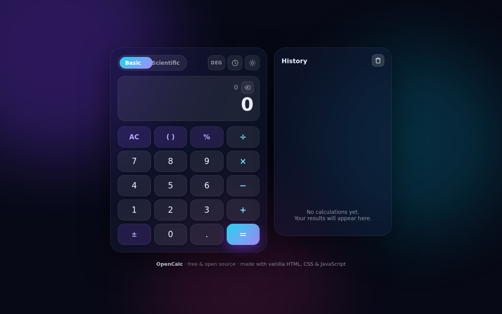
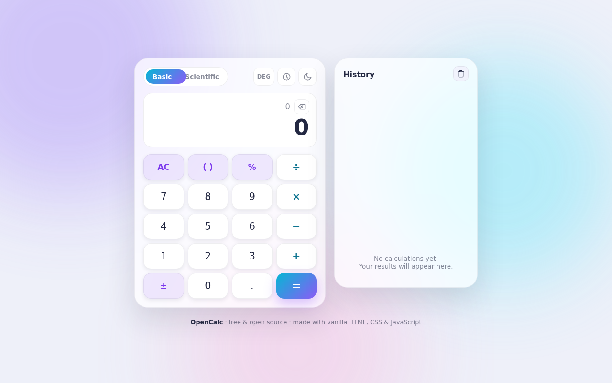
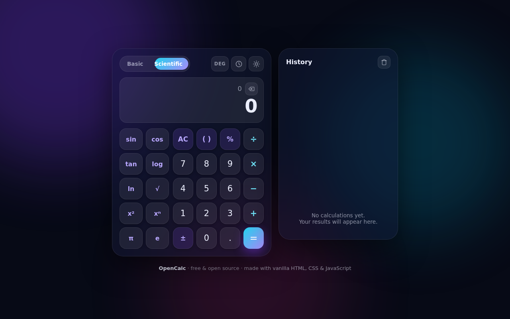
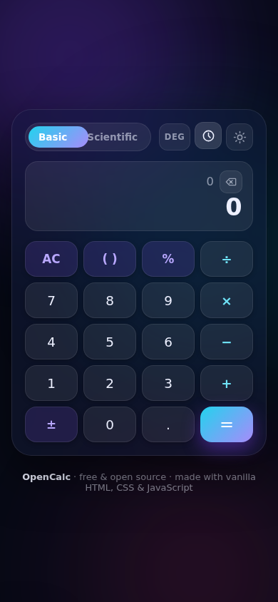

<div align="center">

# 🔢 OpenCalc

**A beautiful, animated, zero-dependency calculator for the web.**

Basic & scientific modes · Dark & light themes · Calculation history ·
Pure HTML + CSS + JavaScript — no frameworks, no build step, no `npm install`

[](LICENSE)


[](#-contributing)

</div>

## Screenshots

| Dark | Light |
| --- | --- |
|  |  |

| Scientific mode | Mobile |
| --- | --- |
|  |  |

## ✨ Features

- **Two modes** — a clean basic keypad, plus a scientific mode (sin, cos, tan,
  log, ln, √, x², xⁿ, π, e) that slides in with a smooth animated toggle.
- **Real expression engine** — a hand-written recursive-descent parser with
  correct precedence (`2+3×4 = 14`), parentheses, right-associative powers
  (`2^3^2 = 512`), implicit multiplication (`2π`, `2(3+1)`), factorial (`5!`),
  percent, and DEG/RAD angle modes.
- **Live preview** — the result updates as you type, before you press `=`.
- **History panel** — every calculation is saved (and remembered between
  visits via `localStorage`); click any entry to reuse its result.
- **Dark & light themes** — a sun/moon toggle, remembered between visits, with
  a flash-free load (the theme is applied before first paint).
- **Everything animated** 🎬 — springy key presses, ripple effects, popping
  results, shaking errors, sliding panels, floating background orbs. All CSS,
  and all disabled automatically for users with `prefers-reduced-motion`.
- **Zero dependencies** — three files of plain HTML/CSS/JS. Open `index.html`
  and it works. No build step, no package manager, no framework.
- **Friendly error handling** — division by zero, `√−4`, `tan(90°)` and
  malformed input show a clear error instead of `NaN`.

## 🚀 Getting started

No installation needed:

```bash
git clone https://github.com/<your-username>/opencalc.git
cd opencalc
```

…then just open `index.html` in your browser. That's it.

Prefer a local server? Any of these work:

```bash
python3 -m http.server 8080     # then visit http://localhost:8080
npx serve .
```

### 🌍 Publish it on GitHub Pages

1. Push this folder to a GitHub repository.
2. In the repo: **Settings → Pages → Source → Deploy from a branch**.
3. Choose `main` and `/ (root)`, save.
4. Your calculator is live at `https://<your-username>.github.io/opencalc/`.

## 🧮 How it works

```
opencalc/
├── index.html            markup for the calculator, history panel and icons
├── css/
│   └── style.css         themes, layout and every animation
├── js/
│   ├── parser.js         the expression engine (tokenizer + recursive-descent parser)
│   └── app.js            keypad input, live preview, themes, history, ripples
├── tests/
│   └── parser.test.js    57 unit tests — runs with plain Node, no test framework
└── docs/                 screenshots
```

The heart of OpenCalc is `js/parser.js`, a tiny recursive-descent parser.
It turns an expression like `12+7×(3−1)` into tokens, then evaluates them with
this grammar (lowest to highest precedence):

```
expression := term  (('+' | '−') term)*
term       := unary (('×' | '÷') unary)*        — implicit × handled here
unary      := ('−' | '+') unary | power
power      := postfix ('^' unary)?              — right associative
postfix    := primary ('!' | '²' | '%')*
primary    := number | constant | '(' expression ')' | function unary
```

Results are rounded to 12 significant digits, so `0.1+0.2` shows `0.3`
instead of `0.30000000000000004`. The file is UMD-style, so the same code
runs in the browser (`window.OpenCalcParser`) and in Node (for the tests).

## 🧪 Tests

The parser has a zero-dependency test suite — it runs with plain Node:

```bash
node tests/parser.test.js
```

You should see all tests pass. If you add a feature to the parser, please add
a test for it in the same PR. 💜

## 🗺️ Roadmap — good first issues

Want to contribute but don't know where to start? These are small,
self-contained features:

- [ ] ⌨️ **Keyboard support** — type digits and `+ - * /`, `Enter` for `=`,
      `Backspace`, `Escape` for AC. (Listen on `document`, map keys to the
      existing `insert()` / action functions in `js/app.js`.)
- [ ] 🧠 **Memory buttons** — an MC / MR / M+ / M− row.
- [ ] 📐 **Unit converter tab** — length, weight, temperature.
- [ ] 📱 **PWA** — a service worker + manifest so OpenCalc installs offline.
- [ ] 🌐 **i18n** — extract UI strings and add a second language.

## 🤝 Contributing

Contributions are welcome!

1. Fork the repo and create your branch from `main`.
2. Keep the zero-dependency promise — no frameworks, no npm packages.
3. Run `node tests/parser.test.js` before submitting.
4. Open a pull request with a short description of what changed.

Bug reports and feature ideas are just as welcome —
[open an issue](../../issues) and tell us what you'd like to see.

## 📄 License

[MIT](LICENSE) — free to use, study, change and share.
